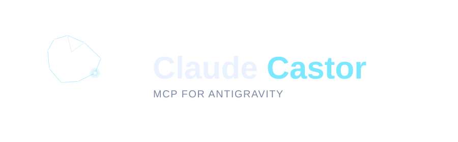

<p align="center">
  <picture>
    <source media="(prefers-color-scheme: dark)" srcset="assets/logo.svg">
    <source media="(prefers-color-scheme: light)" srcset="assets/logo-light.svg">
    
  </picture>
</p>

<p align="center">
  <a href="https://github.com/aahlijia/claude-castor/stargazers"></a>
  <a href="https://github.com/aahlijia/claude-castor/releases"></a>
  <a href="LICENSE"></a>
  
</p>

> An Antigravity MCP for Claude Code.

Offloads large-context work (file exploration, indexing, summarization, deep
research) to Google's free [Antigravity CLI](https://antigravity.google)
(`agy`), the terminal coding agent powered by Gemini models. Claude
orchestrates and reasons; Antigravity handles the heavy lifting.

No API key required. Uses Google sign-in (free individual tier). Optionally
add [NVIDIA NIM](docs/nim.md)'s free hosted models as a
second offload target (needs a free NVIDIA API key).

If Claude Castor saves you tokens or time, consider starring the repo, it
helps other Claude Code users find it.

> **Note:** Antigravity CLI replaces the retired Gemini CLI (shut down
> June 18, 2026). The Antigravity tools keep their `gemini_*` names for
> compatibility, but they now drive the `agy` binary.

---

## How It Works

1. Claude recognizes a task that would benefit from a large context window
2. Claude constructs a context-rich prompt describing the task and what it needs
3. Claude calls `gemini_prompt` via the MCP bridge
4. The server passes the prompt inline to the `agy --print` CLI as a subprocess
5. agy's response comes back as a tool result Claude uses to continue the task

In **agent mode** (`trust=True`), agy auto-approves tool actions
(`--dangerously-skip-permissions`) and, rooted at `cwd`, actively explores the
project on its own (navigating files, grepping for patterns, following
imports) rather than working from pre-loaded context.

---

## Prerequisites

- Python 3.10+
- [uv](https://docs.astral.sh/uv/)
- [Claude Code](https://claude.ai/code)

---

## Installation

### 1. Install the Antigravity CLI

```bash
curl -fsSL https://antigravity.google/cli/install.sh | bash
```

Verify with `agy --version`.

### 2. Sign in with Google

Run `/castor:auth` (or call the `gemini_auth` tool) for guided sign-in. It hands
you the command to run. Sign-in is interactive, so you run it yourself in the
Claude Code prompt or a terminal:

```bash
agy -p "ok"
```

Complete the Google consent in your browser. One-time step. The token is
stored in the system keyring.

### 3. Clone the repo

```bash
git clone https://github.com/aahlijia/claude-castor
cd claude-castor
```

### 4. Run the installer

```bash
python install.py
```

This registers the MCP server with Claude Code and installs the slash commands
globally. Works on macOS, Linux, and Windows.

### 5. Restart Claude Code

Then run `/castor:status` to confirm everything is wired up.

---

## Claude Desktop App

To use Claude Castor in the Claude desktop app, edit the config file at
`~/Library/Application Support/Claude/claude_desktop_config.json` and add an
entry under `mcpServers`:

```json
{
  "mcpServers": {
    "claude-castor": {
      "command": "/absolute/path/to/uv",
      "args": [
        "run",
        "--directory",
        "/absolute/path/to/claude-castor",
        "server.py"
      ]
    }
  }
}
```

Get your `uv` path with `which uv`. Restart the desktop app after saving.

If you already signed in to Antigravity for Claude Code, authentication carries
over via the system keyring, so no extra steps are needed.

---

## Slash Commands

| Command | Description |
|---|---|
| `/castor:status` | Check Antigravity CLI installation and sign-in |
| `/castor:nim-status` | Check the optional NVIDIA NIM backend (key, model, limits) |
| `/castor:agents` | List agy's built-in specialized agents |
| `/castor:auth` | Sign in to the Antigravity CLI |
| `/castor:explore` | Full codebase exploration in agent mode |
| `/castor:research <topic>` | Deep-dive on a symbol, feature, or file |
| `/castor:index` | Compact, reusable map of the current codebase |
| `/castor:review` | Free second-opinion review of your uncommitted changes |
| `/castor:security-review` | Free security-focused review of your uncommitted changes |
| `/castor:usages <symbol>` | Trace where and how a symbol is used |
| `/castor:explain <error>` | Diagnose an error or stack trace against the codebase |
| `/castor:summarize <path>` | Token-lean summary of a large file or directory |
| `/castor:search <query>` | Find code by natural-language intent |
| `/castor:document <target>` | Draft docstrings/docs in the project's style |
| `/castor:session [list\|show\|delete]` | Inspect and manage conversation sessions |

---

## Tools

The MCP server exposes four families of tools. Full reference in [docs/](docs/README.md).

| Family | Tools | Reference |
|---|---|---|
| Antigravity (`gemini_*`) | `gemini_prompt`, workflow tools (`gemini_index`, `gemini_review`, `gemini_security_review`, `gemini_find_usages`, `gemini_explain_error`, `gemini_summarize`, `gemini_semantic_search`, `gemini_document`), `gemini_start` for background jobs, status | [docs/agy.md](docs/agy.md) |
| NVIDIA NIM (`nim_*`, optional) | Prompts, reviews, a read-only agent and its roles (scout, first-pass review, log triage, explain row) | [docs/nim.md](docs/nim.md) |
| Shared (`castor_*`) | Collect background jobs, manage sessions, clear the cache. Works with either backend. | [docs/agy.md](docs/agy.md#shared-tools) |
| Run tier (`castor_*`) | Start an allowlisted suite script in the background, list runs, compare logs | [docs/run-tier.md](docs/run-tier.md) |

---

## Documentation

- [docs/agy.md](docs/agy.md): the `gemini_*` tools, agent mode, sessions, caching
- [docs/nim.md](docs/nim.md): the optional NVIDIA NIM backend (setup, tools, configuration)
- [docs/run-tier.md](docs/run-tier.md): background suite runs and run compare
- [docs/troubleshooting.md](docs/troubleshooting.md)
- [docs/development.md](docs/development.md): checks to run before committing, evals, roadmap
- [GEMINI.md](GEMINI.md): the prompting guide Claude reads (installed to `~/.claude/`)
